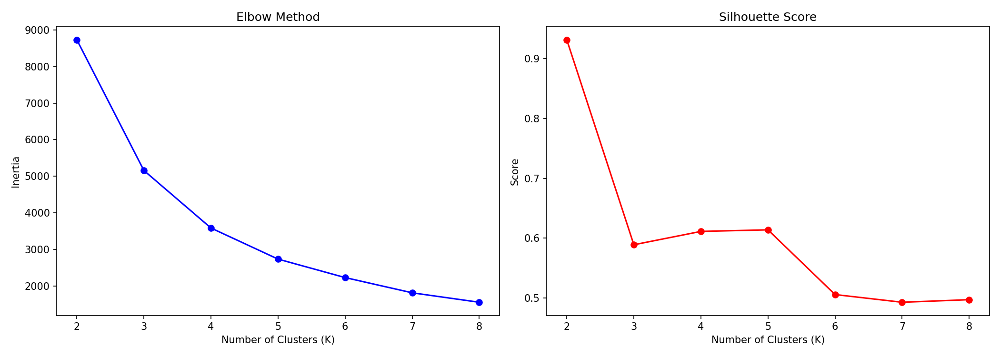
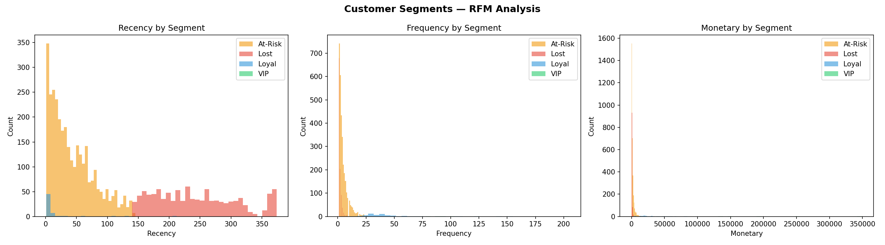
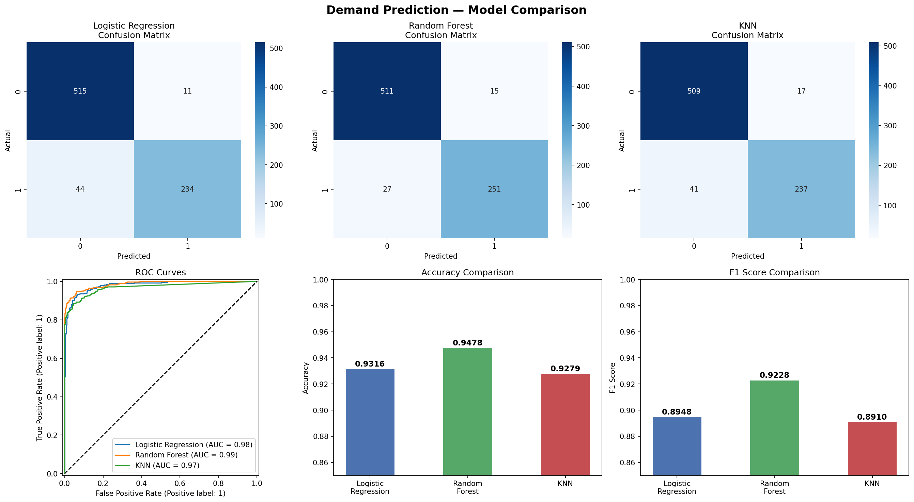

# 🛒 Customer Segmentation & Product Demand Prediction

Machine-learning project on the **Online Retail II** dataset, with two goals:

1. **Marketing:** group customers into actionable segments with **RFM analysis + K-Means**.
2. **Supply chain:** predict which products will be in **high demand**, comparing Logistic Regression, KNN and Random Forest.

CS280 (Introduction to Artificial Intelligence) team project at MedTech – South Mediterranean University, Spring 2026.

## 1. Customer segmentation (RFM + K-Means)

- Built **Recency, Frequency, Monetary** features for each customer and standardised them
- Chose **K = 4** with the elbow method and silhouette score (**0.61**)



| Segment | Customers | Profile | Marketing action |
|---|---|---|---|
| 💎 VIP | 5 | Very recent, very frequent, very high spend | Exclusive loyalty programme |
| ⭐ Loyal | 59 | Recent, frequent, high spend | Rewards & personalised offers |
| ⚠️ At-Risk | 3,201 | Moderate recency & frequency | Re-engagement campaigns |
| 💤 Lost | 1,047 | Inactive for months, rarely buy | Win-back campaigns or lower spend |



## 2. Demand prediction (classification)

Product-level features (total revenue, number of orders, number of customers, average price) are used to predict a **high-demand** label. Models were tuned with **GridSearchCV**.

| Model | Accuracy | Precision | Recall | F1 | AUC |
|---|---|---|---|---|---|
| Logistic Regression | 93.2 % | 96 % | 84 % | 0.895 | 0.98 |
| KNN | 92.8 % | 93 % | 85 % | 0.891 | 0.97 |
| **Random Forest** | **94.8 %** | 94 % | **90 %** | **0.923** | **0.99** |

**Random Forest** was selected: its higher recall matters most in a supply chain, where missing a high-demand product means lost sales.



## Run it

```bash
pip install pandas numpy matplotlib seaborn scikit-learn openpyxl jupyter
# download the dataset into data/ (see data/README.md)
jupyter notebook AI_project.ipynb
```

## Tech stack

Python · pandas · NumPy · scikit-learn · Matplotlib · Seaborn · Jupyter

## Team

Amine Ben Nasrallah · Adem Arroum · Asser Hermassi · Mehdi Kassab · Houssem Rafraf

📄 [Full report](docs/report.pdf)
